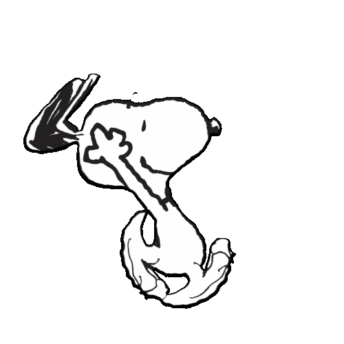

  

 

<h2 align="center">♡ Sobre mí ♡</h2>

**♡ Lo que me mueve**

Disfruto del desarrollo cuando una interfaz se ve bien y además funciona muy bien. 
Me motiva ayudar a que una persona haga en menos tiempo algo que antes le tomaba mucho, 
con soluciones flexibles que se adapten a lo que necesita.

 

**♡ De lo que me siento orgullosa**

De no rendirme ante las dificultades y de ver cómo el esfuerzo 
se refleja en un proyecto terminado, bonito y funcional.

 

**♡ Mi meta**

Seguir aprendiendo y creciendo con nuevas tecnologías, 
hasta construir algo significativo que tenga un impacto real 
en las personas que lo usen.

 

**♡ Fuera del código**

Leo · Dibujo · Películas y series

 

<h2 align="center">♡ Tecnologías ♡</h2>

  

 

